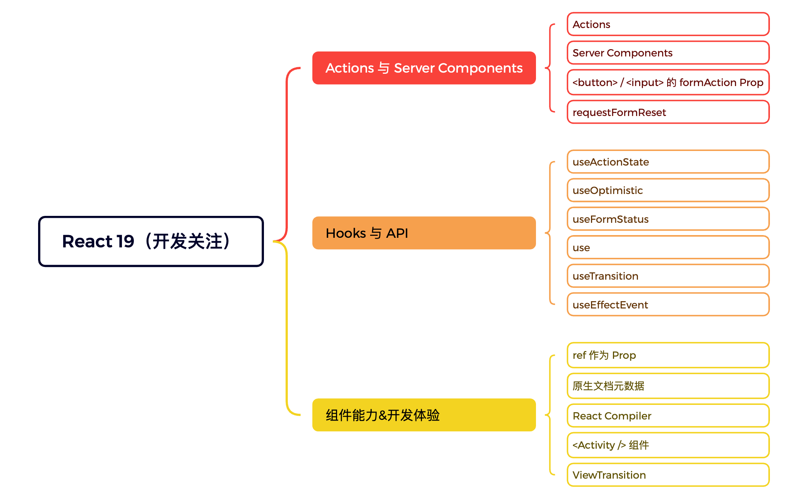

> 10 分钟读完 · 标签：React · 难度：进阶



React 19 的更新可以分成三条主线：**表单与数据流（Actions / Server Components）**、**新增 Hooks**、**组件能力与开发体验**。

## 一、Actions 与 Server Components

围绕"提交表单"这条最常见的数据流，React 19 把它做成了一等公民。

### Actions

把异步函数直接交给表单提交 / 按钮点击，React 自动管理 `pending`、错误和重新渲染，不再手写一堆 `useState`。

```tsx
function SubscribeForm() {
  async function subscribe(formData: FormData) {
    "use server";
    await api.subscribe(formData.get("email"));
  }

  return (
    <form action={subscribe}>
      <input name="email" />
      <button type="submit">订阅</button>
    </form>
  );
}
```

### Server Components（RSC）

组件在服务端渲染，不进客户端 bundle；可以直接异步取数，传给客户端的只有结果。

```tsx
// 默认就是 Server Component：可以用 async，可以直接连数据库
export default async function ArticleList() {
  const articles = await db.article.findMany();
  return <ul>{articles.map(a => <li key={a.id}>{a.title}</li>)}</ul>;
}

// 需要交互（onClick / useState）的组件才显式标记为客户端组件
"use client";
export function LikeButton() { /* ... */ }
```

### `formAction` Prop

`<button>`、`<input>` 可以直接挂 `formAction`，一个表单可以有多个不同用途的提交按钮，无需 JS 手动分发。

```tsx
<form action={save}>
  <button formAction={save}>保存草稿</button>
  <button formAction={publish}>直接发布</button>
</form>
```

### `requestFormReset`

在 Action 里调用，提交成功后表单自动重置。

```tsx
"use server";
import { experimental_formReset as formReset } from "react";

export async function createTodo(formData: FormData, actionContext: string) {
  await db.todo.create({ title: formData.get("title") });
  formReset(actionContext); // 重置触发这次提交的表单
}

// 调用方传入 form 这个 action
<form action={createTodo}>
  <input name="title" />
</form>
```

## 二、Hooks 与 API

上面这套数据流配套的新 Hooks。

### useActionState

拿到 Action 的返回结果 + `pending` 状态，管理表单结果展示。

```tsx
function RegisterForm() {
  const [message, formAction, isPending] = useActionState(
    async (prevState, formData) => {
      const err = await api.register(formData);
      return err ?? "注册成功";
    },
    null
  );

  return (
    <form action={formAction}>
      <input name="email" />
      <button disabled={isPending}>{isPending ? "提交中…" : "注册"}</button>
      <p>{message}</p>
    </form>
  );
}
```

### useOptimistic

先展示"预期结果"，请求失败自动回滚，交互不卡顿。

```tsx
function MessageList({ messages, addMessage }) {
  const [optimisticMessages, addOptimistic] = useOptimistic(
    messages,
    (state, content) => [...state, { id: "pending", content }]
  );

  return (
    <form action={async (formData) => {
      const content = formData.get("content");
      addOptimistic(content);      // 立刻上屏
      await addMessage(content);   // 失败则自动回滚
    }}>
      <input name="content" />
      <ul>{optimisticMessages.map(m => <li key={m.id}>{m.content}</li>)}</ul>
    </form>
  );
}
```

### useFormStatus

只能在 `<form>` 的**子组件**里调用，读取父表单的提交状态（如禁用按钮）。

```tsx
function SubmitButton() {
  const { pending } = useFormStatus();
  return <button disabled={pending}>{pending ? "登录中…" : "登录"}</button>;
}

// 放在 form 内部才能读到 form 的状态
<form action={login}>
  <SubmitButton />
</form>
```

### use

在渲染中读取 Promise / Context，且允许出现在 `if`、循环里（突破旧 Hooks 规则）。

```tsx
import { use, Suspense } from "react";

function Repos({ reposPromise }) {
  const repos = use(reposPromise); // 也可以在条件分支里调用
  return <ul>{repos.map(r => <li key={r.id}>{r.name}</li>)}</ul>;
}

// Promise 抛出时由 Suspense 兜底
<Suspense fallback={<Loading />}>
  <Repos reposPromise={fetchRepos()} />
</Suspense>
```

### useTransition

把一次更新标记为"非紧急"，输入框等紧急交互不会被大列表渲染卡住。

```tsx
function Search() {
  const [isPending, startTransition] = useTransition();
  const [query, setQuery] = useState("");
  const [results, setResults] = useState([]);

  function onChange(e) {
    setQuery(e.target.value); // 紧急：输入立刻回显
    startTransition(() => {
      setResults(filter(e.target.value)); // 非紧急：慢渲染
    });
  }

  return <input value={query} onChange={onChange} />;
}
```

### useEffectEvent

在 Effect 里使用"事件逻辑"，不必把它写进依赖数组，也不会因重建 Effect 而重复触发。

```tsx
function Room({ roomId }) {
  const theme = useContext(ThemeContext);

  const onShowMessage = useEffectEvent((message) => {
    showNotification(message, theme); // 始终读到最新 theme，无需进依赖
  });

  useEffect(() => {
    const id = setInterval(() => onShowMessage("hi"), 1000);
    return () => clearInterval(id);
  }, [roomId]); // 只有 roomId 变化才重连

  return <Chat roomId={roomId} />;
}
```

## 三、组件能力 & 开发体验

### ref 作为 Prop

函数组件直接把 `ref` 当普通 prop 接收，不再需要 `forwardRef`。

```tsx
function Input({ ref }) {
  return <input ref={ref} />;
}

function Form() {
  const inputRef = useRef(null);
  useEffect(() => inputRef.current?.focus(), []);
  return <Input ref={inputRef} />;
}
```

### 原生文档元数据

在组件里直接写 `<title>`、`<meta>`，React 负责提升到 `<head>` 并去重。

```tsx
export default function ProductPage({ product }) {
  return (
    <>
      <title>{product.name} - 商品详情</title>
      <meta name="description" content={product.desc} />
      <div>{/* 页面内容 */}</div>
    </>
  );
}
```

### React Compiler

构建期自动做记忆化，大多数场景不再手写 `useMemo` / `useCallback` / `memo`。

```tsx
// next.config.js
module.exports = { experimental: { reactCompiler: true } };

// 业务代码：下面这份在 React 18 需要 useMemo，编译器会自动记忆化
function TodoList({ todos, tab }) {
  const visible = todos.filter(t => t.tab === tab);
  return <ul>{visible.map(t => <li key={t.id}>{t.text}</li>)}</ul>;
}
```

### `<Activity />` 组件

切换显示时保持另一分支的状态和 DOM 不销毁，替代手动"保活"。

```tsx
import { Activity } from "react";

function Tabs({ showChat }) {
  return (
    <>
      <Activity mode={showChat ? "visible" : "hidden"}>
        <ChatPanel />   {/* 隐藏时草稿、滚动位置、请求状态都保留 */}
      </Activity>
      <Activity mode={showChat ? "hidden" : "visible"}>
        <SettingsPanel />
      </Activity>
    </>
  );
}
```

### ViewTransition

配合 `default` / `name` / `enter` / `exit` / `update` 属性，为元素的出现 / 消失 / 更新写原生过渡动画。

```css
.reveal {
  view-transition-name: panel;
}
::view-transition-old(root),
::view-transition-new(root) {
  animation: fade-in 0.3s ease;
}
```

```tsx
function Gallery() {
  const [show, setShow] = useState(false);
  const [, startTransition] = useTransition();

  return (
    <>
      <button onClick={() => startTransition(() => setShow(s => !s))}>
        切换
      </button>
      {show && (
        <div className="reveal" enterAnimation={fade} exitAnimation={fade}>
          大图
        </div>
      )}
    </>
  );
}
```

## 小结

一句话记忆：**表单交给 Actions，渲染交给 Server Components，性能交给 Compiler，动效交给 ViewTransition。**
